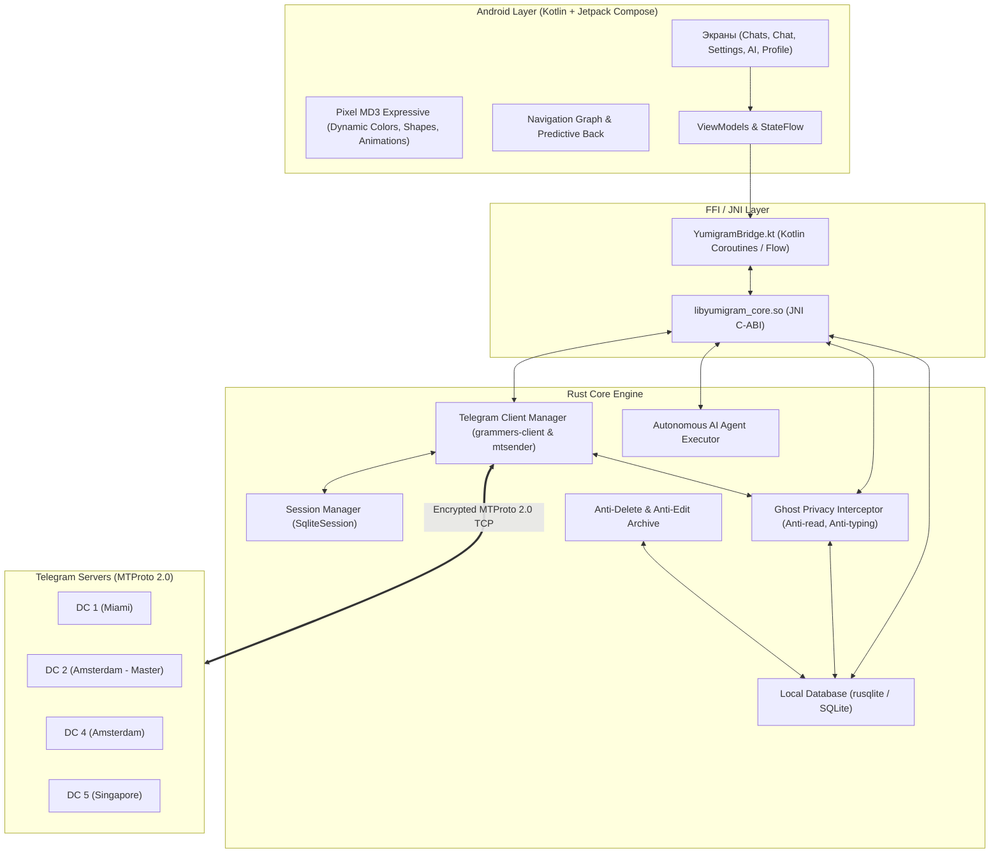

# 🏛️ ARCHITECTURE SPECIFICATION — YUMIGRAM

> **Архитектурный принцип**: «Строгая модульность, безопасность памяти в Rust, нулевые утечки в Android UI, отсутствие монолитного спагетти-кода».

---

## 1. Общая диаграмма системы

---

## 2. Разделение ответственности модулей

### Модуль 1: Rust Core (`core/`)
* **`models.rs`**: Строгие структуры данных (`ChatItem`, `MessageItem`, `GhostConfig`, `AgentAction`). Никаких нетипизированных `HashMap`.
* **`db.rs`**: SQLite-движок с поддержкой:
  * Кеширования чатов и сообщений для мгновенного холодного старта (<100ms).
  * Транзакционного сохранения истории.
  * **Anti-Delete**: При получении серверного события `DeleteMessages`, запись в БД **не удаляется**, а получает флаг `is_deleted = 1`.
  * **Anti-Edit**: При получении серверного события `EditMessage`, исходный текст архивируется в поле `original_text`.
* **`ghost.rs`**: Потокобезопасный диспетчер приватности (`Arc<RwLock<GhostConfig>>`):
  * Перехватывает вызовы `readHistory`: не отправляет серверу подтверждение прочтения при включенном режиме.
  * Блокирует отправку статуса набора текста `setTyping`.
* **`client.rs`**: Управление сессиями и пулом сетевых отправителей `SenderPool`. Асинхронное подключение к дата-центрам Telegram.
* **`agent.rs`**: Исполнитель команд автономного ИИ-агента с поддержкой чтения контекста чатов, подготовки черновиков и изменения настроек профиля.

### Модуль 2: FFI / JNI Bridge (`android/.../bridge/`)
* **Асинхронность**: Все вызовы к Rust-ядру выполняются на пуле `Dispatchers.IO`. Никаких блокировок главного UI-потока (Main Thread).
* **Сериализация**: Использование безопасной сериализации Kotlinx.serialization / serde_json.
* **Graceful Degradation**: При падении или отсутствии нативной библиотеки приложение не крашится, а логирует ошибку и переходит в безопасный режим.

### Модуль 3: Android UI (`android/.../ui/`)
* **Pixel MD3 Expressive**:
  * Динамические палитры Monet (`dynamicDarkColorScheme` / `dynamicLightColorScheme`).
  * Системные жесты Predictive Back (Android 14/15).
  * Обработка экранных отступов (`WindowInsets`, `imePadding`, `navigationBarsPadding`).
* **Кастомные компоненты**:
  * Адаптивные пузыри сообщений (выбор между хвостиками, скругленными плашками и плоским стилем).
  * Индикаторы прочтения (точки `•` / `••`, галочки `✓` / `✓✓`, сердечки `♡` / `♥`).

---

## 3. Требования к безопасности и надежности
1. **Безопасность памяти**: Вся криптография и работа с сетевыми пакетами изолированы в Rust (защита от buffer overflow, use-after-free).
2. **Сессии**: Хранятся в изолированном защищенном каталоге приложения (`getFilesDir()`).
3. **Ghost Mode Integrity**: Логика перехвата работает на уровне ядра, исключая случайную утечку статуса прочтения при скролле.
