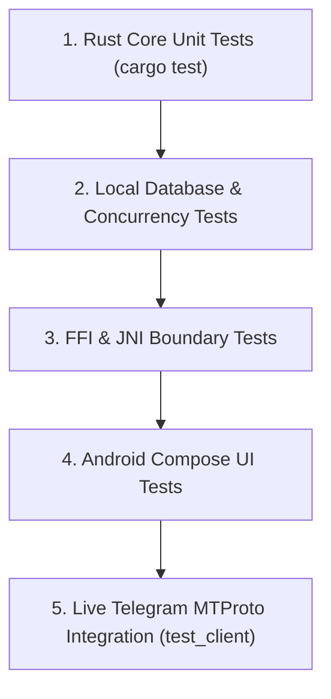

# 🧪 TESTING STRATEGY & QA VERIFICATION — YUMIGRAM

> **Политика качества**: «Функция не считается готовой только потому, что написан код. Статус VERIFIED присваивается только после успешного прохождения автоматизированных тестов и проверки граничных случаев».

---

## 1. Уровни тестирования

---

## 2. Автоматизированные тесты в Rust Core

### Необходимые тест-сьюты:
1. **Тестирование локальной БД (`db_tests.rs`)**:
   * Создание и миграция таблиц в `:memory:`.
   * Сохранение и извлечение списка чатов с сортировкой по дате последнего сообщения.
   * **Проверка Anti-Delete**: отправка сообщения $\to$ вызов `mark_message_deleted` $\to$ проверка, что запись существует с флагом `is_deleted == true`.
   * **Проверка Anti-Edit**: вызов `mark_message_edited` $\to$ проверка сохранения первоначального текста в `original_text`.
2. **Тестирование Ghost Mode (`ghost_tests.rs`)**:
   * Проверка срабатывания флагов `hide_read`, `hide_typing`, `hide_online`.
   * Проверка потокобезопасного обновления конфигурации через `RwLock`.
3. **Тестирование AI Агента (`agent_tests.rs`)**:
   * Проверка валидации входных параметров для действий `read_chat`, `summarize`, `update_bio`.
   * Проверка корректной обработки несуществующих чатов.

---

## 3. Регламент ручного и интеграционного тестирования

1. **Сетевой MTProto тест**:
   * Запуск бинарного файла `test_client`.
   * Проверка handshake с дата-центром Telegram (DC 2/4).
   * Проверка сессионного файла SQLite на сохранение ключей авторизации.
2. **Проверка утечек памяти**:
   * Использование `LeakCanary` в Android для отслеживания удержания контекста активностей.
   * Проверка освобождения нативных JNI-ссылок (`DeleteLocalRef`).
